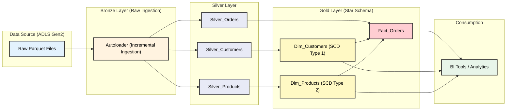
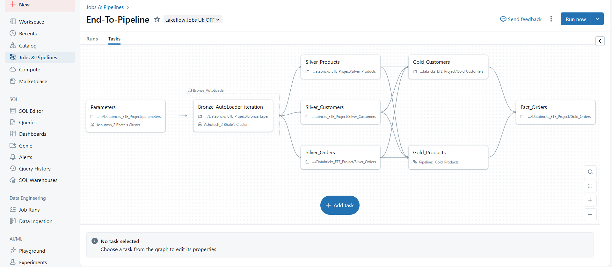
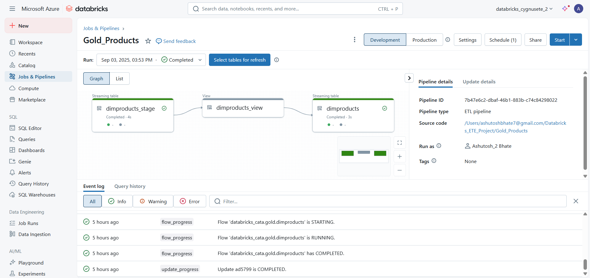
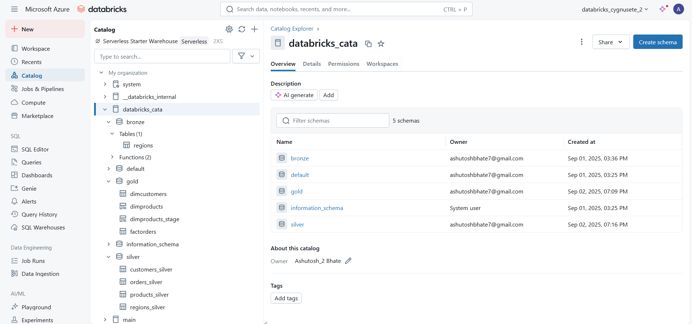

# End-to-End Data Engineering Pipeline on Azure Databricks

## Project Overview

This project demonstrates a complete, end-to-end data engineering pipeline built on the Azure cloud platform using Azure Databricks. It ingests raw transactional data, processes it through a multi-layered **Medallion Architecture** (Bronze, Silver, Gold), and models it into a **Star Schema** optimized for analytics.

The pipeline leverages modern data engineering practices, including incremental data loading with **Spark Structured Streaming** and **Autoloader**, implementation of **Slowly Changing Dimensions (SCD Type 1 & 2)**, and automated workflow orchestration using **Databricks Jobs**.

---

## Technology Stack

* **Cloud Platform**: Microsoft Azure
* **Data Lake**: Azure Data Lake Storage (ADLS) Gen2
* **Processing Engine**: Azure Databricks, Apache Spark (PySpark)
* **Data Format**: Parquet (Bronze), Delta Lake (Silver and Gold)
* **Ingestion**: Databricks Autoloader, Spark Structured Streaming
* **Orchestration**: Databricks Jobs
* **Declarative Pipeline**: Delta Live Tables, for the product dimension
* **Governance**: Unity Catalog

---

## Architecture Diagram

The entire pipeline is orchestrated within Azure Databricks, reading from and writing to ADLS Gen2. The flow follows the Bronze-Silver-Gold paradigm to progressively refine the data into a Star Schema.

---

## Key Features

* **Medallion Architecture**: Segregates data into Bronze (raw), Silver (cleaned), and Gold (modelled as a star schema) layers.
* **Incremental Ingestion**: Uses Autoloader to efficiently process only new data, avoiding full re-scans.
* **Slowly Changing Dimensions**: Customers use SCD Type 1 (overwrite, with a Delta MERGE); products use SCD Type 2 (historical tracking, with Delta Live Tables).
* **Star Schema Modeling**: Creates optimized dimension and fact tables in the Gold layer for fast analytical queries.
* **Automated Orchestration**: Utilizes Databricks Jobs to define dependencies and automate the end-to-end workflow.
* **Schema Handling & Data Quality**: Auto Loader infers and stores each source's schema and keeps values that don't fit in a `_rescued_data` column; Delta Lake rejects writes whose schema doesn't match the table; Delta Live Tables expectations drop products without an ID or a name.

---

## Pipeline in Action

Here are some snapshots of the key components of the project running in Databricks.

* **End-to-End Job Orchestration:**
*This image shows the directed acyclic graph (DAG) of the entire pipeline, with tasks for each layer and their dependencies*

* **Delta Live Tables (DLT) Pipeline:**
*This is the DLT pipeline that builds the product dimension (SCD Type 2) in the Gold layer*

* **Final Star Schema in Catalog Explorer:**
*The final dimension and fact tables are registered in Unity Catalog and ready for consumption*

---

## Setup and Execution
**1. Prerequisites:**

* An Azure account with an active subscription.
* An Azure Databricks workspace configured with Unity Catalog.
* Appropriate permissions to create and manage clusters, jobs, and ADLS Gen2 storage.
* An Access Connector for Azure Databricks with access to the storage account, and Unity Catalog external locations for its containers.

**2. Configuration:**

* Clone this repository to your Databricks workspace.
* The storage account (`databrickscygnusete`) and catalog (`databricks_cata`) names are written directly in each notebook in `notebooks/Notebook_Files/`; replace them with yours. `parameters.ipynb` lists the datasets the Bronze step loops over.

**3. Data Ingestion:**

* Upload the `*_first` files from the sample_data directory into folders named `orders`, `customers` and `products` in the `source` container, and the `*_second` files after the first run, to see the incremental load. `regions.parquet` is loaded separately, as the table `databricks_cata.bronze.regions`.

**4. Execution:**

* Execute the notebooks manually in order to materialize the tables for the first time, with `init_load_flag` set to 1 in Gold_Customers (0 on later runs). Gold_Products is a Delta Live Tables pipeline: create a pipeline from it instead of running it as a notebook. After that, the Databricks Job runs the whole workflow in order.
